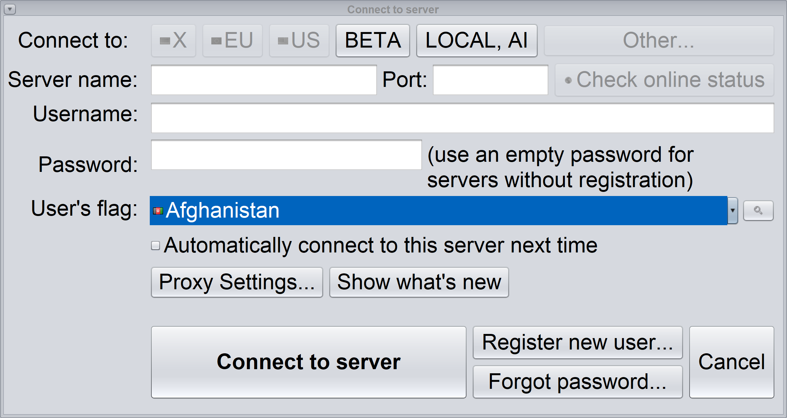
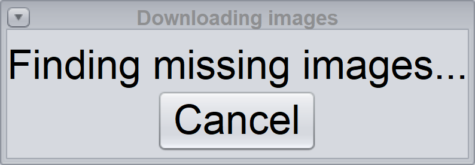
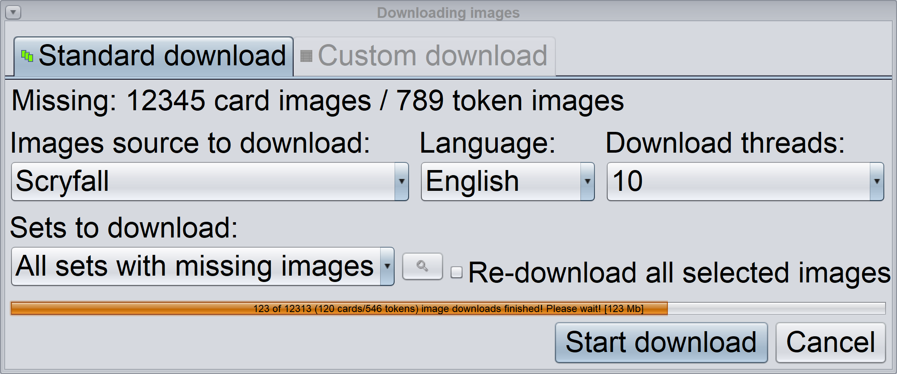

# Startup and image-download dialog corrections (2026-10-15)

The installed build exposed clipping missed by the earlier outer-bounds checks. Three regressions first failed: connection commands remained outside a startup-sized viewport after maximization, loading Cancel extended below its panel, and download controls extended below fixed-height rows. A hidden native peer also exposed a Java 8 scroll-tab header-height mismatch.

The fix remeasures original dialog content and removes the desktop scroll wrapper when it is no longer needed. Other requested dialog sizes that fit remain intact. Image-download modes use natural sizes, with labels above their controls. Worker messages and mode changes run on the EDT. The two-tab layout uses the standard wrapping policy so Java 8 includes its actual header height.

## Verification

Combined commit: `c7ecebb28f4611e028b7ef6e3550f98f81bedc34`. Foundation: `46e6d7d2a8b4c68f421e2736acc1929cc6d310df`.

- Windows Java 17/21 combined client suite: 66 cases, 56 passed, 10 pre-existing skips; zero failures/errors.
- Java 8 with bundled JavaFX combined suite: 66 cases, 55 passed, 11 pre-existing skips; zero failures/errors.
- Installed client jar on its bundled Java 17: all five new dialog tests pass at each simulated scale 1.25, 1.5 and 2.0.
- New coverage: fonts 14/17/23/34, startup desktop growth, small-desktop scrolling, loading/options transitions and EDT worker messages. Hidden native peers supply device font measurements without opening a desktop window.
- All 16 edited forms regenerated in NetBeans 8.2. Regenerated Java compiled with release 8 and passed 41 GUI tests.
- No new physical monitor or mouse/keyboard checks were performed for this correction. Earlier native evidence in test-results.md applies to the earlier commit documented there.

| Isolated Java 21 branch | Cases | Passed | Skipped |
| --- | ---: | ---: | ---: |
| codex/gui-font-layout | 47 | 37 | 10 |
| codex/gui-draft-divider | 51 | 41 | 10 |
| codex/gui-damage-layout | 50 | 40 | 10 |
| codex/gui-popup-position | 49 | 39 | 10 |
| codex/gui-hidpi-rendering | 53 | 43 | 10 |
| codex/gui-deck-filter | 51 | 41 | 10 |

All isolated runs used clean client builds and in-memory preferences, with zero failures/errors.

## Reproduction

```text
mvn -B -ntp -pl Mage.Client test "-Dtest=DialogLayoutTest" "-Djava.util.prefs.PreferencesFactory=mage.client.util.gui.GuiTestPreferencesFactory"
```

Construct the connection dialog at font 34 on a 1000x650 desktop, then grow to 1920x950 and show it. Connect/Register/Forgot password/Cancel must fit the visible content, with no unnecessary outer scrollbar. At 800x500, scrolling must reach Cancel.

Check both image-download modes at fonts 14/17/23/34. Labels and commands must fit all ancestor containers. Update messages and modes from a worker thread, then drain the EDT before checking.

## Background rendering from the installed client jar

These are fixture component captures at simulated 200%, font 34, using a hidden native peer for correct device font measurements. They do not show desktop input. Preferences are in memory, with no user credentials or data.






