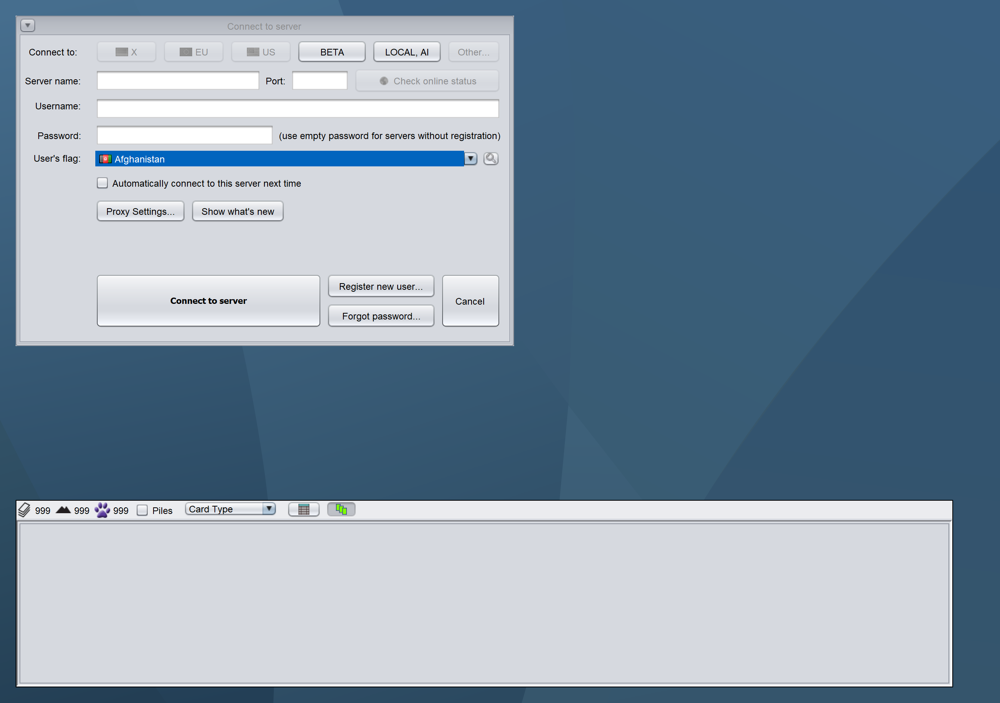

# Separate crash fix and audited font policy

The refresh-threading fix is an independent contribution based directly on upstream master. Its only production change is a five-line EDT dispatch guard in GUISizeHelper.refreshGUIAndCards. Its two tests have no dependency on the scaling fixtures. The worker regression fails on unchanged upstream; it passes after the fix, while EDT callers still observe synchronous refreshes.

The six scaling branches exclude that production fix and its test. GUISizeHelper is byte-for-byte identical to upstream on all six branches. Default font values, preset keys/values and the slider range are unchanged. The obsolete global look-and-feel refresh from the abandoned font override has been removed. Original per-control bindings are retained: standard controls use their form/look-and-feel fonts, existing preference-bound menu/table/prompt text retains its existing preference. Windows/Java2D display transforms supply DPI scaling without an extra font multiplier. Damage amount spinners retain their original look-and-feel font binding; their editor font sizes are checked across native styles.

The actual selectable range is **7–99**. Earlier descriptions incorrectly said 10–50. The standard-control font/size and main-toolbar height regressions now cover every value from 7 through 99. The user's local reset to baseline values is excluded from every PR and is not a change to application defaults.

Upstream base: `492369c7844b8d76479f0393ff9eb6b0b0cf30d7`. Foundation: `9aeafb41952bcadea23f39ffdd2437617ff9230b`. Combined staged build: `2574db4d9466ff096ec3361ca181088ef39504f1`. Independent crash fix: `aff72e290905abbb375db30801c413c2167b92ba`.

## Validation

| Scope / JVM | Cases | Passed | Skipped |
| --- | ---: | ---: | ---: |
| Standalone crash fix / Java 8 | 27 | 16 | 11 |
| Standalone crash fix / Java 17 | 27 | 17 | 10 |
| Standalone crash fix / Java 21 | 27 | 17 | 10 |
| Combined build / Java 8 | 70 | 59 | 11 |
| Combined build / Java 17 | 70 | 60 | 10 |
| Combined build / Java 21 | 70 | 60 | 10 |
| codex/gui-font-layout / Java 21 | 49 | 39 | 10 |
| codex/gui-draft-divider / Java 21 | 53 | 43 | 10 |
| codex/gui-damage-layout / Java 21 | 52 | 42 | 10 |
| codex/gui-popup-position / Java 21 | 51 | 41 | 10 |
| codex/gui-hidpi-rendering / Java 21 | 55 | 45 | 10 |
| codex/gui-deck-filter / Java 21 | 53 | 43 | 10 |

All completed suites have zero failures/errors; listed skips are pre-existing. The staged combined jar passes 45 GUI tests at each simulated scale 1.0, 1.25, 1.5 and 2.0. All 15 unchanged edited forms retain their successful NetBeans regeneration; their regenerated Java compiles for release 8 and passes the updated 45 GUI tests.

## Matched rendering

All 22 original/staged screenshot pairs have zero differing pixels. They cover settings 14/17/23/34, native 100% and 200% graphics devices, simulated fractional/200% transforms, the picked-card toolbar and the full deck-editor form. The deck-editor comparisons hold the divider at 678 on both sides. These are hidden-peer component renders, not mouse-input screenshots. Both sides use the same runtime/look and feel and matching pane state.

The captures in this report load the newly staged combined jar. The working C: installation remains at the previously tested `1857e0b8fb1ba6f4e13793f1f3e441f489123fde`; it was not replaced during the PR extraction. In that installed build, the operator confirmed a real image-download and window-drag test at 200% worked. The agent observed startup, dragged the discovery dialog, saw the real Scryfall download running and found zero new GUI crashes in the test's log segment. The full 26490-image queue was not independently observed to completion. This live observation is distinct from the standalone PR's automated checks.

Original upstream, baseline preference 14 on the native 200% device:

Staged combined build, identical settings:

The earlier installed-build evidence remains available at its original immutable revision. Current results and source attribution are in font-policy-audit-results.json and the sanitized measurements committed with this report.
