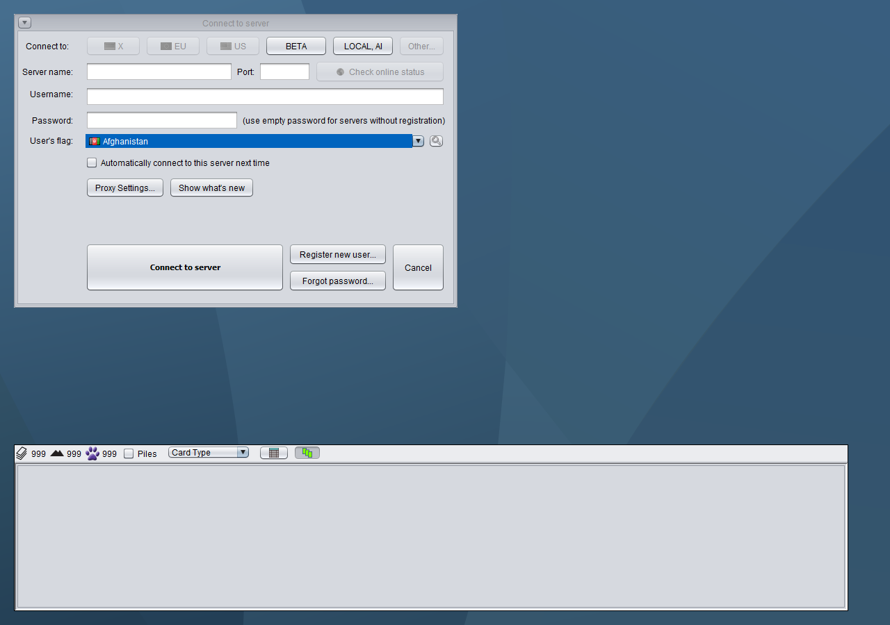
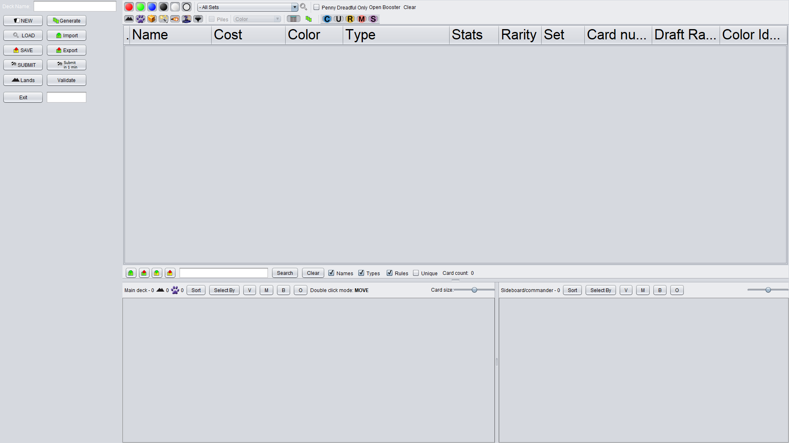

# Preserve original sizing at 100%

The dialog-font preference previously affected selected application widgets, while standard Swing controls retained look-and-feel or form fonts. Preserve those existing bindings for every font setting. Native Java2D display transforms provide DPI scaling; the layout helper does not replace fonts or apply an additional DPI font multiplier.

The correction also retains the original deck-editor sidebar command dimensions and selector layout. A horizontal viewport permits flexible layouts to fill the available width, with scrolling below their minimum. Empty non-UI-resource borders prevent Nimbus from adding six pixels of padding during style changes. Original compact size hints are retained; explicitly enlarged fonts may expand their size hints.

Baseline client source: `492369c7844b8d76479f0393ff9eb6b0b0cf30d7`. Combined: `289f3462386e20d6ffdbaf27c3d0ac2947cf5c63`. Foundation: `d73d8e43153fd29476795d944bde645672350d56`.

## Matched original/installed comparisons

Every pair uses the same Java 17 runtime, look and feel, preference values, canvas and pane settings. The original client was freshly built from unchanged upstream source; the corrected captures load the actual client jar installed in C:.

- Connection dialog and picked-card toolbar: all pixels match at settings 14, 17, 23 and 34.
- The same four settings also match using a hidden native peer on the actual Windows 100%-scale graphics device, without overriding Java's scale.
- Full deck-editor form: all pixels match at settings 14 and 34 on a 1920x1080 canvas. Both sides use divider location 678 to hold pane state constant; this tests control sizing rather than automatic initial splitter allocation.
- Simulated 125%, 150% and 200%: all pixels match at settings 14 and 34.
- The regression suite additionally checks standard-control fonts and preferred sizes for every selectable dialog-font value, 10 through 50. Existing manual font preferences remain effective for the widgets that used them before.

These are background component renders attached to hidden native peers for device font measurements, not desktop input screenshots. No Windows display setting was changed. Full-editor fixtures use empty production forms with matching pane positions, not a running game or populated deck.

| Pair | Scale | Dialog setting | Differing pixels |
| --- | ---: | ---: | ---: |
| native100-font14 | 1.0 | 14 | 0 |
| native100-font17 | 1.0 | 17 | 0 |
| native100-font23 | 1.0 | 23 | 0 |
| native100-font34 | 1.0 | 34 | 0 |
| 100-font14 | 1.0 | 14 | 0 |
| 100-font17 | 1.0 | 17 | 0 |
| 100-font23 | 1.0 | 23 | 0 |
| 100-font34 | 1.0 | 34 | 0 |
| scale1.25-font14 | 1.25 | 14 | 0 |
| scale1.25-font34 | 1.25 | 34 | 0 |
| scale1.5-font14 | 1.5 | 14 | 0 |
| scale1.5-font34 | 1.5 | 34 | 0 |
| scale2-font14 | 2.0 | 14 | 0 |
| scale2-font34 | 2.0 | 34 | 0 |
| deck-100-font14 | 1.0 | 14 | 0 |
| deck-100-font34 | 1.0 | 34 | 0 |

## Tests and compatibility

- Actual installed jar, bundled Java 17: all 43 GUI tests pass at each simulated scale 1.0, 1.25, 1.5 and 2.0.
- Combined Windows Java 17/21: 68 cases, 58 passed, 10 pre-existing skips; zero failures/errors.
- Combined Java 8 with bundled JavaFX: 68 cases, 57 passed, 11 pre-existing skips; zero failures/errors.
- All 15 edited forms regenerate in NetBeans 8.2. Regenerated Java compiles for release 8 and passes 43 GUI tests.
- Existing dependencies, user preference values, and client/server compatibility are retained.
- Saved divider positions remain respected. The controlled deck comparison above does not claim identical automatic initial pane allocation.
- Earlier physical 125%/150% interaction evidence is historical; it is not relabeled as validation of this revision.

| Isolated clean Java 21 branch | Cases | Passed | Skipped |
| --- | ---: | ---: | ---: |
| codex/gui-font-layout | 49 | 39 | 10 |
| codex/gui-draft-divider | 53 | 43 | 10 |
| codex/gui-damage-layout | 52 | 42 | 10 |
| codex/gui-popup-position | 51 | 41 | 10 |
| codex/gui-hidpi-rendering | 55 | 45 | 10 |
| codex/gui-deck-filter | 53 | 43 | 10 |

All branch runs have zero failures/errors.

```text
mvn -B -ntp -pl Mage.Client test "-Dtest=GuiLayoutUtilTest,DialogLayoutTest" "-Djava.util.prefs.PreferencesFactory=mage.client.util.gui.GuiTestPreferencesFactory"
```

## Screenshots

Actual 100%-device peer, font setting 34. Original:



Installed correction, same settings:


Deck-editor form, 100%, setting 34, matching divider state. Original:


Installed correction:



Installed at simulated 200%, setting 34:


All pairs and sanitized component measurements are committed alongside this report. See standard-sizing-comparisons.json and standard-sizing-screenshot-manifest.json for exact dimensions, results and hashes.
